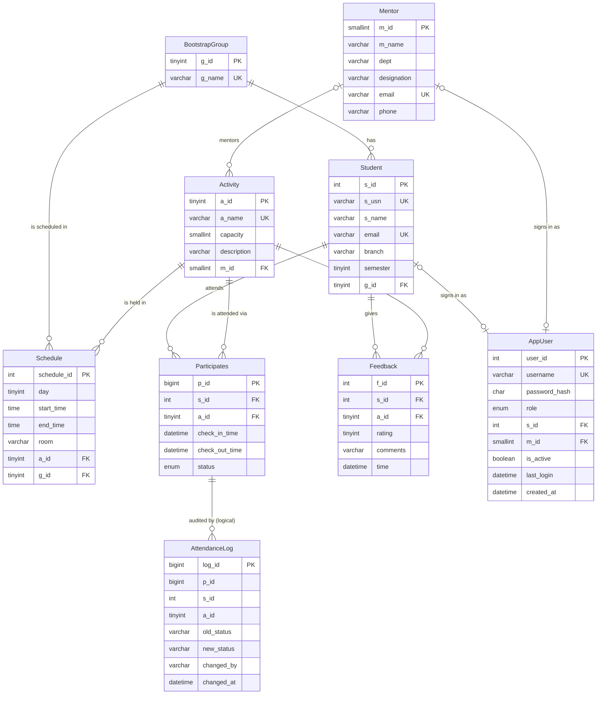
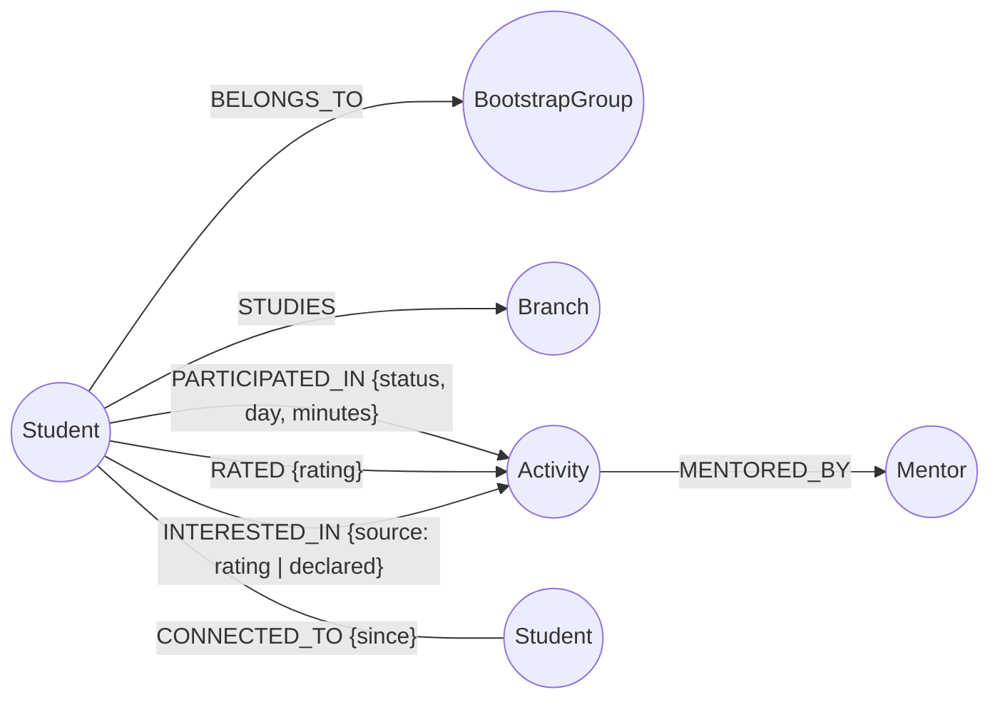
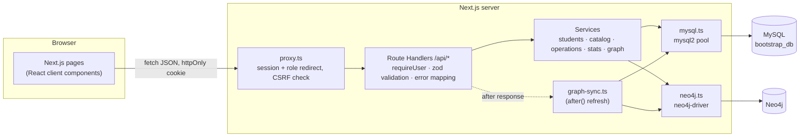
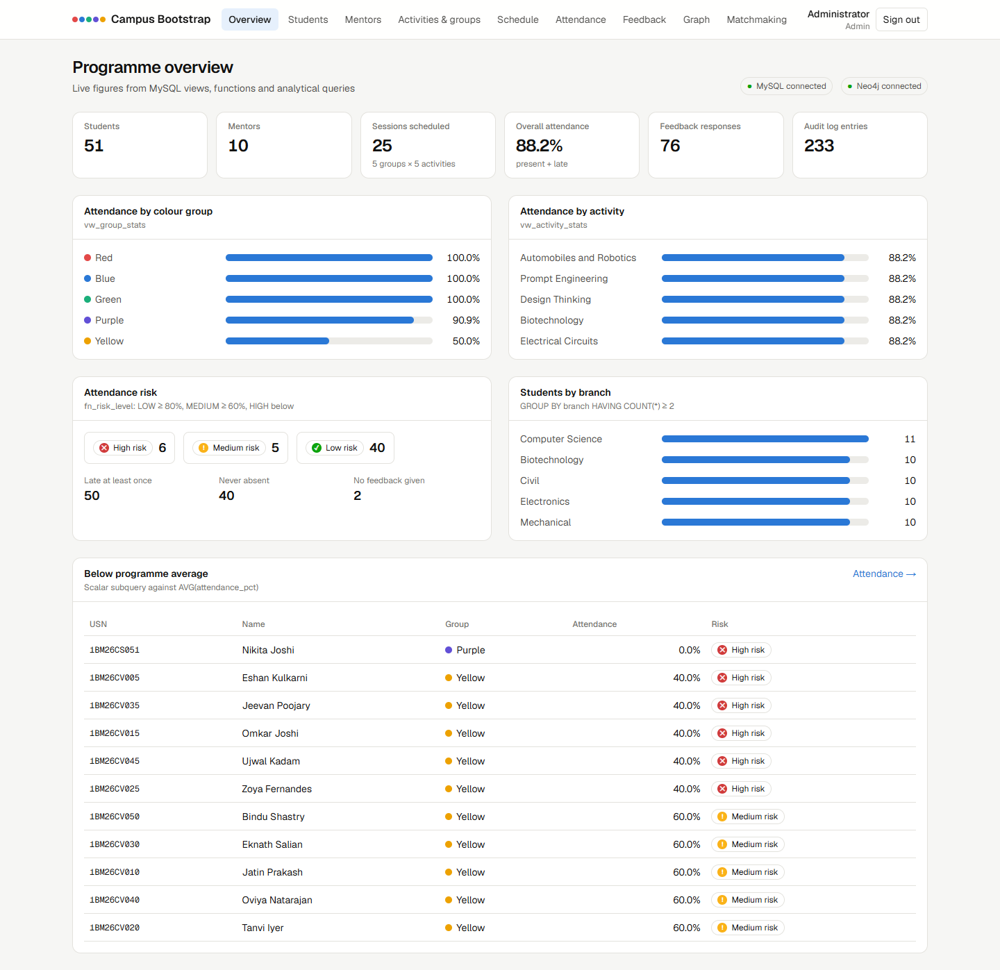
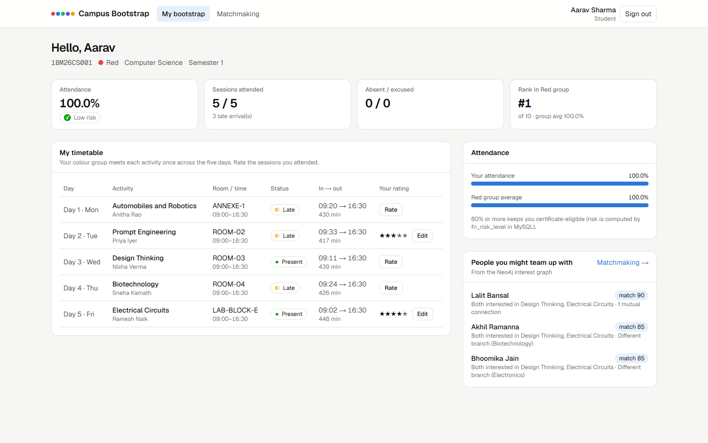
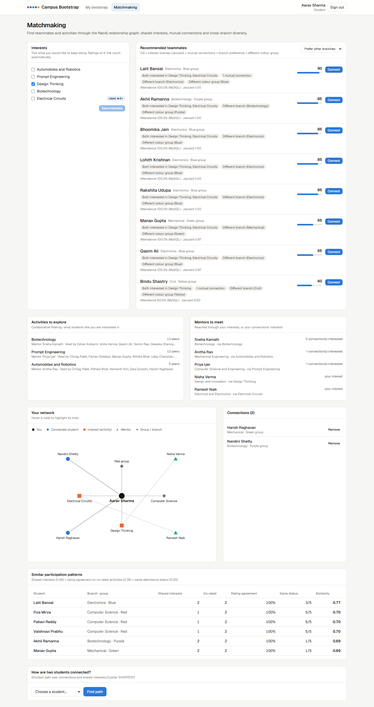

# Campus Bootstrap Matchmaking & Student Statistics DB

**DBMS Experiential Learning — Level 3 Mini Project**
**Team:** PES2UG24CS451 and PES2UG24CS456
**Stack:** MySQL 8 + Neo4j + Next.js

---

## Contents

1. [Problem statement](#1-problem-statement)
2. [Objectives](#2-objectives)
3. [Scope](#3-scope)
4. [Functional requirements](#4-functional-requirements)
5. [Database choice and justification](#5-database-choice-and-justification)
6. [Relational design](#6-relational-design)
7. [Data dictionary](#7-data-dictionary)
8. [SQL implementation](#8-sql-implementation)
9. [Neo4j implementation](#9-neo4j-implementation)
10. [Important queries](#10-important-queries)
11. [System architecture](#11-system-architecture)
12. [Authentication, authorisation and security](#12-authentication-authorisation-and-security)
13. [Application screens](#13-application-screens)
14. [Testing](#14-testing)
15. [Team contributions](#15-team-contributions)
16. [Conclusion and future enhancements](#16-conclusion-and-future-enhancements)

---

## 1. Problem statement

New students join the campus through a five-day **bootstrap programme**. They are split into five colour groups (Red, Blue, Green, Purple, Yellow), and each group spends one day in each of five hands-on activities: Automobiles & Robotics, Prompt Engineering, Design Thinking, Biotechnology and Electrical Circuits. Each activity is run by a faculty mentor.

Running this on spreadsheets causes three problems:

1. **Scheduling and attendance are error-prone.** A room can be double-booked. A group can be sent to the wrong activity. Late arrivals are judged by hand. A record changed after the fact leaves no trace.
2. **Nobody can see how the programme is going while it runs.** Coordinators cannot tell which groups or activities are losing students, who is at risk of missing the certificate, or what students are saying about each session.
3. **Students leave without knowing each other.** The programme exists to help students from different branches find people to build things with, but the only links students get are the people in their own colour group.

The project builds a database-backed web application. **MySQL** enforces the programme's rules and produces the statistics. **Neo4j** models the relationships between students, activities and mentors, so it can recommend teammates, follow-up activities and mentors.

## 2. Objectives

1. Model the programme in a normalised relational schema in which the rules are enforced by the database itself: the rotation, capacity, attendance timing, who may give feedback, and auditability.
2. Show advanced SQL features where they solve a real problem: constraints, indexes (composite, covering, full-text), views, stored functions, stored procedures, triggers, cursors, transactions with savepoints and row locks, window functions.
3. Model the relationships between students, activities and mentors as a graph in Neo4j, and use graph traversal for matchmaking that would be awkward in SQL.
4. Provide a Next.js web interface with three roles (admin, mentor, student), so that every database feature is reachable through a real workflow.
5. Keep the application secure: hashed passwords, signed sessions, role checks on every endpoint, parameterised queries, and secrets only in environment variables.
6. Verify the system with automated tests at the unit, database and HTTP levels.

## 3. Scope

**In scope**
- Master data: groups, mentors, activities, students, application accounts.
- The 5 × 5 rotation (Latin square), rooms and session times.
- Attendance: check-in/out, late detection, excusals, absences, and an append-only audit log.
- Feedback (1–5 stars plus a comment), full-text search, rating distributions.
- Statistics: attendance by group, activity, branch and student; risk levels; rankings.
- The graph: interests (declared, or derived from 4–5★ ratings), peer connections, recommendations, similarity, paths, network insights.
- Three-role web application with authentication.

**Out of scope**
- Registration by students themselves (admins enrol students).
- More than five groups or five activities: the rotation procedure and the Latin-square rule are fixed at 5 × 5.
- Email or push notifications, and certificate generation.
- Multi-campus or multi-programme tenancy.

## 4. Functional requirements

| ID | Requirement | Role | Implemented by |
|---|---|---|---|
| FR-1 | Sign in with email and password; sign out; change password | All | `/api/auth/*`, `AppUser`, bcrypt |
| FR-2 | Each role is confined to its own dashboard and data | All | `proxy.ts`, `requireUser`, `resolveStudentId` |
| FR-3 | Enrol a student with five participation rows and a login, atomically | Admin | `sp_register_student` |
| FR-4 | Edit, transfer (between groups) and delete students; deletion is refused once attendance exists | Admin | `UPDATE`, `sp_transfer_student`, `trg_student_protect` |
| FR-5 | Search and filter students by name/USN/email, group, branch, semester, risk; sort | Admin | `vw_student_attendance` |
| FR-6 | Manage mentors (with optional login) and assign them to activities | Admin | app transaction, `Activity.m_id` (ON DELETE SET NULL) |
| FR-7 | Edit activities (capacity 1–500) and rename groups | Admin | CHECK constraints, UNIQUE keys |
| FR-8 | View and edit the rotation grid; regenerate it before the programme starts | Admin | `Schedule`, room-clash triggers, `sp_generate_rotation` |
| FR-9 | Check students in and out, set check-in times, excuse, mark absent, bulk-excuse | Mentor, Admin | `sp_check_in`, `sp_check_out`, `trg_part_set_status`, `sp_mark_absentees` |
| FR-10 | Every attendance status change is logged with who made it | System | `trg_part_audit`, `@app_user` |
| FR-11 | Students see their timetable, status per session, attendance %, risk and rank | Student | `vw_student_schedule`, `fn_attendance_pct`, window functions |
| FR-12 | Students rate sessions they attended (one rating per activity, editable) | Student | `sp_submit_feedback`, `trg_feedback_validate` |
| FR-13 | Staff review feedback with full-text search and rating distributions | Mentor, Admin | `ft_feedback_comments` |
| FR-14 | Programme dashboard: totals, attendance by group/activity/branch, risk, below-average students | Admin | views + analytical queries |
| FR-15 | Students declare interests and connect with peers | Student | Neo4j `INTERESTED_IN`, `CONNECTED_TO` |
| FR-16 | Recommend teammates, activities and mentors, with the reasons behind each score | Student (staff read-only) | Cypher (§9.4) |
| FR-17 | Show similar students, the student's network, and the shortest path to any student | All | Cypher |
| FR-18 | Network insights: centrality, co-interest, cross-branch bridges, mentor reach | Mentor, Admin | Cypher |
| FR-19 | Keep Neo4j in step with MySQL (full rebuild and per-student refresh) | Admin / System | `graph-sync.ts`, `after()` |

## 5. Database choice and justification

The two databases are used for different kinds of data, not to duplicate each other.

| Data | Where | Why |
|---|---|---|
| Students, mentors, groups, activities, accounts | **MySQL** | Fixed structure; uniqueness (USN, email) and referential integrity matter more than flexibility. |
| Rotation, attendance, feedback | **MySQL** | Business rules have to hold on every write: one group per activity per day, capacity, "late after 15 minutes", only attendees may rate, the audit trail. Triggers, CHECK constraints and transactions do this inside the database, whatever the client. |
| Statistics and reports | **MySQL** | Aggregation over well-structured rows (GROUP BY, HAVING, window functions, views) is what SQL is built for. |
| Interests, peer connections, recommendations | **Neo4j** | The questions are about *paths*: "students who like what I like", "friends of my friends", "mentors my friends' interests lead to", "how am I connected to X". In SQL these need repeated self-joins or recursive CTEs of unknown depth; in Cypher they are short pattern matches, and the cost depends on the neighbourhood size rather than the table size. |
| Peer connections and declared interests | **Neo4j only** | They have no relational purpose (no report or rule depends on them). They are naturally edges, so storing them only as edges avoids a junction table that would just mirror the graph. |

**MySQL is the source of truth for records.** Neo4j nodes carry the MySQL primary keys (`s_id`, `g_id`, `a_id`, `m_id`), so every node maps to exactly one row, and the derived part of the graph can be rebuilt from MySQL at any time.

The vector-database option was not used. The project's unstructured text (feedback comments) is short, and searched by keyword relevance. MySQL `FULLTEXT` indexes cover that need without another system.

## 6. Relational design

### 6.1 ER diagram (final schema)



`bootstrap_relational_schema_diagram.png` in the repository root shows the original seven tables. The diagram above adds the columns introduced by ALTER (`semester`, `phone`, `comments` widened to 1000), `AttendanceLog`, and the application's `AppUser` table.

### 6.2 Relational schema

Underline = primary key, *italic* = foreign key.

- **BootstrapGroup**(<u>g_id</u>, g_name)
- **Mentor**(<u>m_id</u>, m_name, dept, designation, email, phone)
- **Activity**(<u>a_id</u>, a_name, capacity, description, *m_id* → Mentor)
- **Student**(<u>s_id</u>, s_usn, s_name, email, branch, semester, *g_id* → BootstrapGroup)
- **Schedule**(<u>schedule_id</u>, day, start_time, end_time, room, *a_id* → Activity, *g_id* → BootstrapGroup); UNIQUE(day, g_id), UNIQUE(day, a_id)
- **Participates**(<u>p_id</u>, *s_id* → Student, *a_id* → Activity, check_in_time, check_out_time, status); UNIQUE(s_id, a_id)
- **Feedback**(<u>f_id</u>, *s_id* → Student, *a_id* → Activity, rating, comments, time); UNIQUE(s_id, a_id)
- **AttendanceLog**(<u>log_id</u>, p_id, s_id, a_id, old_status, new_status, changed_by, changed_at); no FKs on purpose, so the history survives deletes
- **AppUser**(<u>user_id</u>, username, password_hash, role, *s_id* → Student, *m_id* → Mentor, is_active, last_login, created_at)

**Cardinalities.** A group has many students and five schedule slots. An activity has five slots, one mentor (optional), and many participation and feedback rows. Participates and Feedback resolve the M:N relationship between Student and Activity, and each carries attributes of that relationship. Student/Mentor to AppUser is 1:0..1.

**Normalisation.** Every table is in 3NF/BCNF: each non-key attribute depends only on the key. Derived values such as attendance %, risk, average rating and minutes attended are **not stored**. Functions and views compute them, so they cannot drift out of date. The two surrogate-key tables with natural candidate keys (Participates and Feedback, on `(s_id, a_id)`) declare those as UNIQUE.

### 6.3 Changes made to the original script (`sql/02_app_extensions.sql`)

The original `Campus_Bootstrap_Mini_Project.sql` was preserved unchanged. It was verified on a clean MySQL 8.0.46 instance: it runs end to end with no errors, and every table, view, routine, trigger, constraint and index it declares is present. Verification surfaced four gaps, which the extension script closes:

| Gap found | Fix |
|---|---|
| `trg_schedule_room_clash` fires only on INSERT, so an UPDATE could double-book a room | `trg_schedule_room_clash_upd` (BEFORE UPDATE) |
| `trg_part_audit` logs `CURRENT_USER()`, which inside a trigger is the **definer** (always `root@localhost`) | The trigger now logs `COALESCE(@app_user, USER())`; the app sets `@app_user` per request |
| `trg_feedback_validate` let **excused** students rate an activity they did not attend | Rejects `absent` and `excused` |
| No accounts or roles for an application | `AppUser` table, role/link triggers, email-sync triggers, `sp_register_student`, demo accounts, least-privilege DB user |

Two views were added for the dashboards: `vw_student_schedule` and `vw_group_stats`.

## 7. Data dictionary

### BootstrapGroup — colour groups
| Column | Type | Constraints | Description |
|---|---|---|---|
| g_id | TINYINT UNSIGNED | PK, AUTO_INCREMENT | Group id (1–5) |
| g_name | VARCHAR(20) | NOT NULL, UNIQUE | Red, Blue, Green, Purple, Yellow |

### Mentor — faculty running activities
| Column | Type | Constraints | Description |
|---|---|---|---|
| m_id | SMALLINT UNSIGNED | PK | Mentor id |
| m_name | VARCHAR(60) | NOT NULL | Full name |
| dept | VARCHAR(60) | | Department |
| designation | VARCHAR(50) | | e.g. Associate Professor |
| email | VARCHAR(120) | NOT NULL, UNIQUE | Contact and login email |
| phone | VARCHAR(15) | CHECK length ≥ 10 (`chk_phone_len`) | Phone number |

### Activity — the five bootstrap activities
| Column | Type | Constraints | Description |
|---|---|---|---|
| a_id | TINYINT UNSIGNED | PK | Activity id (1–5) |
| a_name | VARCHAR(60) | NOT NULL, UNIQUE, FULLTEXT(a_name, description) | Name |
| capacity | SMALLINT UNSIGNED | NOT NULL, CHECK 1–500 | Seats per group session |
| description | VARCHAR(255) | FULLTEXT | What happens in the session |
| m_id | SMALLINT UNSIGNED | FK → Mentor, ON DELETE SET NULL | Assigned mentor (optional) |

### Student
| Column | Type | Constraints | Description |
|---|---|---|---|
| s_id | INT UNSIGNED | PK | Student id |
| s_usn | VARCHAR(15) | NOT NULL, UNIQUE | University seat number |
| s_name | VARCHAR(80) | NOT NULL | Full name |
| email | VARCHAR(120) | NOT NULL, UNIQUE | Email; also the login username |
| branch | VARCHAR(60) | composite index (g_id, branch) | Engineering branch |
| semester | TINYINT UNSIGNED | NOT NULL, DEFAULT 1, CHECK 1–8 | Current semester |
| g_id | TINYINT UNSIGNED | NOT NULL, FK → BootstrapGroup, ON DELETE RESTRICT | Colour group |

### Schedule — the rotation
| Column | Type | Constraints | Description |
|---|---|---|---|
| schedule_id | INT UNSIGNED | PK | Slot id |
| day | TINYINT UNSIGNED | NOT NULL, CHECK 1–5 | Programme day |
| start_time / end_time | TIME | NOT NULL, CHECK end > start | Session times |
| room | VARCHAR(20) | index (day, room); no clash per day (triggers) | Room |
| a_id | TINYINT UNSIGNED | FK → Activity; UNIQUE(day, a_id) | Activity in this slot |
| g_id | TINYINT UNSIGNED | FK → BootstrapGroup; UNIQUE(day, g_id) | Group in this slot |

### Participates — one row per student per activity
| Column | Type | Constraints | Description |
|---|---|---|---|
| p_id | BIGINT UNSIGNED | PK | Row id |
| s_id | INT UNSIGNED | FK → Student ON DELETE CASCADE; UNIQUE(s_id, a_id) | Student |
| a_id | TINYINT UNSIGNED | FK → Activity; index (a_id, status) | Activity |
| check_in_time | DATETIME | index | Arrival |
| check_out_time | DATETIME | CHECK ≥ check-in | Departure |
| status | ENUM('present','absent','late','excused') | DEFAULT 'absent'; CHECK absent ⇒ no times | Set by triggers from the clock |

### Feedback
| Column | Type | Constraints | Description |
|---|---|---|---|
| f_id | INT UNSIGNED | PK | Row id |
| s_id | INT UNSIGNED | FK → Student ON DELETE CASCADE; UNIQUE(s_id, a_id) | Student |
| a_id | TINYINT UNSIGNED | FK → Activity | Activity |
| rating | TINYINT UNSIGNED | NOT NULL, CHECK 1–5 | Stars |
| comments | VARCHAR(1000) | FULLTEXT | Free-text comment |
| time | DATETIME | DEFAULT CURRENT_TIMESTAMP; restamped on edit | Submitted at |

### AttendanceLog — append-only audit
| Column | Type | Description |
|---|---|---|
| log_id | BIGINT UNSIGNED PK | Entry id |
| p_id, s_id, a_id | — (indexed, no FK) | What changed; kept even if the student is deleted |
| old_status, new_status | VARCHAR(10) | Transition |
| changed_by | VARCHAR(100) | App user's email (via `@app_user`) or DB user |
| changed_at | DATETIME DEFAULT NOW | When |

### AppUser — sign-in accounts
| Column | Type | Constraints | Description |
|---|---|---|---|
| user_id | INT UNSIGNED | PK | Account id |
| username | VARCHAR(120) | NOT NULL, UNIQUE, CHECK email format | Login email |
| password_hash | CHAR(60) | NOT NULL, CHECK bcrypt format | bcrypt hash, never plaintext |
| role | ENUM('admin','mentor','student') | NOT NULL, indexed | Role |
| s_id | INT UNSIGNED | UNIQUE, FK → Student ON DELETE CASCADE | Linked student (role = student) |
| m_id | SMALLINT UNSIGNED | UNIQUE, FK → Mentor ON DELETE CASCADE | Linked mentor (role = mentor) |
| is_active | BOOLEAN | DEFAULT TRUE | Disabled accounts cannot sign in |
| last_login, created_at | DATETIME | | Bookkeeping |

The rule "role matches the linked record" is enforced by triggers (`trg_appuser_link_ins/upd` → `sp_assert_account_link`), because MySQL forbids CHECK constraints on columns that have FK referential actions.

## 8. SQL implementation

### 8.1 DDL
- **CREATE** for 9 tables, 8 views, 5 stored functions, 11 stored procedures and 12 triggers.
- **ALTER** adds columns (`semester`, `phone`) and constraints, widens `comments`, and adds and drops indexes. A scratch table demonstrates CREATE → ALTER (ADD / RENAME / DROP COLUMN) → DROP.
- **Constraints:** PK on every table; 10 FKs with deliberate actions (CASCADE for dependent rows, RESTRICT for groups and activities that still have data, SET NULL for an activity's mentor); UNIQUE natural keys; 11 named CHECK constraints.

### 8.2 Indexes

| Index | Purpose |
|---|---|
| `ix_student_group_branch (g_id, branch)` | Composite: filter by group and branch; replaces two single-column indexes (EXPLAIN confirms use) |
| `ix_part_activity_status (a_id, status)` | Covers attendance counts per activity and status |
| `ix_schedule_day_room (day, room)` | Supports the room-clash triggers |
| `ix_part_checkin`, `ix_fb_activity`, `ix_log_*`, `ix_appuser_role` | Common lookups |
| `ft_feedback_comments`, `ft_activity_text` | FULLTEXT search (natural-language and boolean modes) |

### 8.3 Views
`vw_timetable`, `vw_student_attendance` (with `fn_attendance_pct` and `fn_risk_level`), `vw_activity_stats`, `vw_attendance_audit`, `vw_activity_ranking` (RANK() window), `vw_circuits_feedback` (updatable, `WITH CHECK OPTION`), and the app's `vw_student_schedule` and `vw_group_stats`.

### 8.4 Stored functions and procedures

| Routine | What it does | Used by |
|---|---|---|
| `fn_attendance_pct`, `fn_risk_level` | Attendance % (late counts as attended) and LOW/MEDIUM/HIGH | Views, dashboards, risk report |
| `fn_activity_rating`, `fn_session_minutes`, `fn_scheduled_day` | Average rating, minutes attended, day a group meets an activity | Views, graph sync |
| `sp_generate_rotation` | Builds the 5 × 5 Latin square; refuses once attendance exists | Admin → Schedule |
| `sp_register_student` | Student + 5 participation rows + login in **one transaction** (EXIT HANDLER → ROLLBACK, RESIGNAL) | Admin → Enrol |
| `sp_transfer_student` | `SELECT … FOR UPDATE` row lock, `SAVEPOINT`, rebuilds participation | Admin → Transfer |
| `sp_check_in`, `sp_check_out` | Time-stamps attendance; status is derived by trigger | Mentor roster |
| `sp_submit_feedback` | Validates enrolment; upserts with `ON DUPLICATE KEY UPDATE` | Student → Rate |
| `sp_mark_absentees` | **Cursor** loop that excuses every remaining absentee | Mentor → Excuse all |
| `sp_group_report`, `sp_search_feedback` | Per-group daily report; ranked full-text search | Admin → Group report |
| `sp_assert_account_link` | Shared check called by the AppUser triggers | Triggers |

### 8.5 Triggers

| Trigger | Rule |
|---|---|
| `trg_schedule_room_clash` / `_upd` | A room holds one group per day (INSERT and UPDATE) |
| `trg_part_validate` | The activity must be on the student's group rotation and within capacity |
| `trg_part_set_status` | On check-in: more than 15 min after the start → `late`, else `present` (unless excused) |
| `trg_part_audit` | Logs every status change with the acting user |
| `trg_feedback_validate` | Only students who attended may rate |
| `trg_feedback_clamp` | Editing a rating re-stamps its time |
| `trg_student_protect` | A student with recorded attendance cannot be deleted |
| `trg_appuser_link_ins` / `_upd` | Account role must match its linked student or mentor |
| `trg_student_email_sync`, `trg_mentor_email_sync` | Login username follows email changes |

### 8.6 Transactions
- **Inside procedures:** `sp_register_student`, `sp_enroll_student` and `sp_transfer_student` use `START TRANSACTION … COMMIT` with an `EXIT HANDLER` that rolls back and re-signals. `sp_transfer_student` also takes a row lock and sets a savepoint.
- **In the application:** creating a mentor together with a login runs as a `mysql2` transaction (`BEGIN … COMMIT/ROLLBACK`). If the login insert fails, the mentor insert is undone too, and a test verifies this.
- **In the SQL script:** COMMIT, ROLLBACK, SAVEPOINT / ROLLBACK TO, and `REPEATABLE READ` with `SELECT … FOR UPDATE`.

### 8.7 How the app uses MySQL
All access goes through `web/src/lib/mysql.ts`, a pooled `mysql2` client:
- Every value is passed through `?` placeholders. Identifiers such as sort columns come from fixed whitelists.
- Before attendance changes, the connection runs `SET @app_user = ?` so the audit trigger records the real person, and clears it afterwards.
- MySQL errors are mapped to HTTP responses (`web/src/lib/api.ts`): `SIGNAL` (1644) → 409 with the trigger's message; duplicate key → 409 naming the field; CHECK violation → 400 with a readable rule; FK errors → 400/409.

## 9. Neo4j implementation

### 9.1 Graph model



| Node | Key (= MySQL PK) | Properties |
|---|---|---|
| `Student` | `s_id` | usn, name, semester |
| `BootstrapGroup` | `g_id` | name |
| `Activity` | `a_id` | name, capacity |
| `Mentor` | `m_id` | name, dept, designation |
| `Branch` | `name` | — (one node per distinct branch) |

| Relationship | Source | Why it is useful |
|---|---|---|
| `BELONGS_TO`, `STUDIES` | Student row | Diversity scoring (different branch or group) and path finding |
| `MENTORED_BY` | Activity.m_id | Student → interest → mentor discovery |
| `PARTICIPATED_IN {status}` | Participates | Comparing attendance patterns between students |
| `RATED {rating}` | Feedback | Rating agreement between students |
| `INTERESTED_IN {source:'rating'}` | Feedback with rating ≥ 4 | Interest inferred from behaviour |
| `INTERESTED_IN {source:'declared'}` | Student's own choice (graph-native) | Explicit interest |
| `CONNECTED_TO {since}` | Student's own action (graph-native) | Social graph: mutual friends, paths, centrality |

**Constraints/indexes** (`neo4j/01_schema.cypher`): uniqueness on every key, an index on `Student.usn`, and a relationship-property index on `INTERESTED_IN.source`.

### 9.2 Synchronisation
`web/src/lib/services/graph-sync.ts`:
- **Full sync** (`npm run graph:sync`, or Admin → Graph → Sync). Loads MySQL with parameterised queries, `MERGE`s nodes by key in `UNWIND` batches, rebuilds the derived relationships, and removes nodes whose rows were deleted. It never touches `CONNECTED_TO` or declared interests. The sync is idempotent, and a test checks that.
- **Incremental refresh.** After a successful MySQL write (feedback, attendance, enrolment, transfer, delete), the route handler schedules `syncStudent(id)` with Next.js `after()`, so the response is not delayed. If Neo4j is down, the MySQL write still succeeds and the next full sync repairs any drift.
- **Demo data** (`--seed-demo`). Deterministic declared interests (following each student's branch) and a sparse connection network, in the same modulo-derived style as the SQL seed.

Loaded graph: 76 nodes (51 students, 10 mentors, 5 activities, 5 groups, 5 branches); 51 `BELONGS_TO`, 51 `STUDIES`, 5 `MENTORED_BY`, 255 `PARTICIPATED_IN`, 76 `RATED`, 101 `INTERESTED_IN`, 66 `CONNECTED_TO`. These counts are asserted against MySQL in the tests.

### 9.3 Why a graph adds value here
- **Teammate matching** combines set similarity of interests, friends-of-friends, and node-type diversity in one traversal. In SQL this would be a self-join of a Student–Interest junction table, plus a self-join of a Connection table twice for mutual friends, plus joins back to Student for branch and group.
- **"How are we connected?"** needs a shortest path of unknown length (`SHORTEST 1 … {1,6}`). SQL would need a recursive CTE with cycle handling.
- **Mentor discovery** follows variable-length paths of mixed relationship types (`INTERESTED_IN|CONNECTED_TO*1..2` then `MENTORED_BY`).
- **Centrality and bridges** count the neighbourhoods of every node.

### 9.4 Recommendation rules

**Teammates (`peerRecommendations`).** The candidates are students who share at least one interest or one mutual connection, and are not already connected.

score = 0.6 · Jaccard(interests) + 0.15 · min(mutuals, 3)/3 + 0.15 · branch preference + 0.1 · [different colour group]

The branch preference is selectable: prefer other branches (the default, for cross-disciplinary teams), prefer the same branch, or none. A different colour group earns a bonus, so students meet people outside their group. Every suggestion lists its reasons and is enriched with the peer's attendance % from MySQL.

**Similar students (`similarStudents`).**

similarity = 0.45 · min(shared interests, 3)/3 + 0.35 · mean(1 − |r₁ − r₂|/4 over co-rated activities) + 0.20 · (same attendance status count)/5

**Activities (`activityRecommendations`)** use collaborative filtering. The student's peers are those sharing an interest with them, or connected to them. Activities those peers are interested in, and the student is not, are ranked by the share of peers supporting them. If there are none, it falls back to overall popularity.

**Mentors (`mentorRecommendations`)** are the mentors reachable through the student's own interests (path length 2) or their connections' interests (length 3), ranked by the number of connections involved.

## 10. Important queries

### SQL (more are in `Campus_Bootstrap_Mini_Project.sql`, Part 5)

**Attendance per activity (view built on GROUP BY + function):**
```sql
SELECT a_name, enrolled, attended, attendance_pct, avg_rating, responses FROM vw_activity_stats;
```
| a_name | enrolled | attended | attendance_pct | avg_rating | responses |
|---|---|---|---|---|---|
| Automobiles and Robotics | 51 | 45 | 88.24 | 2.19 | 16 |
| Prompt Engineering | 51 | 45 | 88.24 | 3.00 | 15 |
| Design Thinking | 51 | 45 | 88.24 | 4.00 | 14 |
| Biotechnology | 51 | 45 | 88.24 | 5.00 | 15 |
| Electrical Circuits | 51 | 45 | 88.24 | 4.00 | 16 |

**Attendance per colour group (`vw_group_stats`):** Red 100.00, Blue 100.00, Green 100.00, Purple 90.91, Yellow 50.00. **Risk distribution:** LOW 40, MEDIUM 5, HIGH 6.

**Rank inside the colour group (window functions, student dashboard):**
```sql
SELECT rank_in_group, group_size, group_avg_pct FROM (
  SELECT s.s_id,
         RANK()   OVER (PARTITION BY s.g_id ORDER BY v.attendance_pct DESC) AS rank_in_group,
         COUNT(*) OVER (PARTITION BY s.g_id)                                  AS group_size,
         ROUND(AVG(v.attendance_pct) OVER (PARTITION BY s.g_id), 2)           AS group_avg_pct
  FROM Student s JOIN vw_student_attendance v ON v.s_id = s.s_id) ranked
WHERE s_id = ?;
```

**Below the programme average (scalar subquery):**
```sql
SELECT s_usn, s_name, colour_group, attendance_pct, risk FROM vw_student_attendance
WHERE attendance_pct < (SELECT AVG(attendance_pct) FROM vw_student_attendance)
ORDER BY attendance_pct;
```

**Branch summary (GROUP BY + HAVING):**
```sql
SELECT branch, COUNT(*) AS students, ROUND(AVG(semester), 2) AS avg_semester
FROM Student GROUP BY branch HAVING COUNT(*) >= 2 ORDER BY students DESC;
```

**Full-text search, natural language and boolean (feedback review page):**
```sql
SELECT f.f_id, a.a_name, f.rating, f.comments,
       MATCH(f.comments) AGAINST(? IN NATURAL LANGUAGE MODE) AS relevance
FROM Feedback f JOIN Activity a ON a.a_id = f.a_id
WHERE MATCH(f.comments) AGAINST(? IN NATURAL LANGUAGE MODE)
ORDER BY relevance DESC;
-- boolean mode, e.g. '+mentor -rushed' or '"soldering practice"'
```
`CALL sp_search_feedback('robot chassis build')` ranks "Joined late but the robotics build was very well run." first (relevance 3.54), ahead of the "Loved building the robot chassis…" comments (1.29).

**EXISTS / NOT EXISTS (overview flags):**
```sql
SELECT (SELECT COUNT(*) FROM Student s WHERE EXISTS
          (SELECT 1 FROM Participates p WHERE p.s_id = s.s_id AND p.status = 'late'))   AS late_once,
       (SELECT COUNT(*) FROM Student s WHERE NOT EXISTS
          (SELECT 1 FROM Feedback f WHERE f.s_id = s.s_id))                             AS no_feedback;
```

### Cypher (all in `neo4j/02_queries.cypher`)

**Teammate matching for student 1 (Aarav Sharma, Computer Science, Red) — top results:**
| Peer | Branch / group | Shared interests | Mutuals | Score |
|---|---|---|---|---|
| Lalit Bansal | Electronics / Blue | Design Thinking, Electrical Circuits | 1 | 0.90 |
| Akhil Ramanna | Biotechnology / Purple | Design Thinking, Electrical Circuits | 0 | 0.85 |
| Bhoomika Jain | Electronics / Blue | Design Thinking, Electrical Circuits | 0 | 0.85 |

**Shortest connection path (student 1 → student 40):**
`Aarav Sharma —INTERESTED_IN— Electrical Circuits —INTERESTED_IN— Oviya Natarajan` (2 hops)

**Collaborative filtering for student 1:** Biotechnology (13 peers, score 0.295), Prompt Engineering (12, 0.273), Automobiles and Robotics (5, 0.114).

**Co-interest pairs:** Prompt Engineering + Design Thinking (9 students), Design Thinking + Electrical Circuits (8), Design Thinking + Biotechnology (8). This suggests which follow-up clubs could be run together.

**Network:** 66 connections, 84.8% of them cross-branch. The best-connected students have degree 6.

## 11. System architecture



**Request flow:**
1. A page calls `/api/...`.
2. `proxy.ts` verifies the session cookie and rejects cross-site writes.
3. The route handler re-checks the role, validates the input with zod, and calls a service.
4. The service runs parameterised SQL and/or Cypher.
5. Database rule violations become 4xx JSON responses.
6. When MySQL data changed, the graph refresh runs after the response has been sent.

**Combined workflows:**
- Teammate recommendations come from Neo4j and are enriched with attendance from MySQL.
- A 5★ rating stored in MySQL becomes an `INTERESTED_IN` edge in Neo4j, which then changes that student's recommendations. The end-to-end test covers this whole path.

**Degradation:** if Neo4j is unreachable, graph endpoints return 503 with a clear message and every MySQL feature keeps working. The admin overview shows the live status of both databases.

## 12. Authentication, authorisation and security

| Concern | Implementation |
|---|---|
| Password storage | bcrypt (cost 10) in `AppUser.password_hash`. A CHECK constraint refuses anything not in bcrypt format, so plaintext cannot be stored even by mistake. |
| Login | Constant-time behaviour for unknown emails (compares against a dummy hash), so response timing doesn't reveal which accounts exist. Inactive accounts are refused. `last_login` is updated. Lockout after 5 failures per IP and email for 15 minutes (HTTP 429). |
| Sessions | HS256 JWT (`jose`), signed with `AUTH_SECRET`, 8-hour expiry, in an `httpOnly`, `SameSite=Lax` cookie (`Secure` in production). Tampered or foreign tokens are rejected. |
| Roles | admin / mentor / student. `proxy.ts` redirects pages; **every** route handler calls `requireUser(req, ...roles)`. Students are pinned to their own `s_id` (`resolveStudentId`); mentors to their own activities (`assertMentorOwnsActivity`). |
| CSRF | SameSite cookie, plus the proxy rejects non-GET API requests whose `Origin` is a different host. |
| Injection | `?` placeholders for all SQL values; `$params` for all Cypher values. Sort keys and procedure names are whitelisted. React escapes all output. |
| Input validation | zod schemas mirror the DB constraints for friendly messages; the database still enforces every rule (CHECK, UNIQUE, FK, triggers). |
| Secrets | Only in `web/.env.local` (git-ignored); `.env.example` has placeholders. Nothing is exposed to the browser (no `NEXT_PUBLIC_` variables). The env schema fails fast on a missing or short `AUTH_SECRET`. |
| Least privilege | `sql/04_app_db_user.sql` creates `bootstrap_app` with DML + EXECUTE only. Routines and triggers run with their definer's rights. |
| Error handling | Unknown errors are logged on the server, and the client gets a generic message, never a stack trace or SQL. |
| Headers | `X-Content-Type-Options: nosniff`, `X-Frame-Options: DENY`, `Referrer-Policy`; `X-Powered-By` removed. |
| Auditing | Every attendance status change is logged with the acting user's email. |

## 13. Application screens

| Screen | Screenshot |
|---|---|
| Sign in | [login.png](screenshots/login.png) |
| Admin overview | [admin-overview.png](screenshots/admin-overview.png) |
| Admin students | [admin-students.png](screenshots/admin-students.png) |
| Admin mentors | [admin-mentors.png](screenshots/admin-mentors.png) |
| Activities and groups | [admin-activities.png](screenshots/admin-activities.png) |
| Rotation grid | [admin-schedule.png](screenshots/admin-schedule.png) |
| Attendance | [admin-attendance.png](screenshots/admin-attendance.png) |
| Feedback review | [admin-feedback.png](screenshots/admin-feedback.png) |
| Graph admin | [admin-graph.png](screenshots/admin-graph.png) |
| Mentor dashboard | [mentor-dashboard.png](screenshots/mentor-dashboard.png) |
| Student dashboard | [student-dashboard.png](screenshots/student-dashboard.png) |
| Matchmaking | [student-matchmaking.png](screenshots/student-matchmaking.png) |





Screenshots are regenerated with `npm run screenshots` against a running app.

## 14. Testing

### 14.1 Method

| Level | Tool | What it covers |
|---|---|---|
| Script verification | `mysql` client on a clean MySQL 8.0.46 instance | The base script and extensions run without errors; every declared object exists |
| Unit (36) | Vitest | Validation schemas, DB-error mapping, JWT signing and tampering, student scoping, login lockout, peer-score weights |
| MySQL integration (24) | Vitest + mysql2 | Schema objects; Latin-square property; index use (EXPLAIN); functions vs raw rows; every CHECK constraint; every trigger; procedures incl. rollback on failure; application transaction rollback; full-text natural and boolean search |
| Neo4j integration (9) | Vitest + neo4j-driver | Node/relationship counts equal MySQL counts; idempotent sync; constraints; recommendation invariants (no self, no existing connection, sorted, bounded); connect/disconnect; interests; similarity; ego graph; shortest path |
| End-to-end API (23) | Vitest + fetch against the production build | Sign-in, bad credentials, lockout, page redirects, role matrix, data scoping, CSRF rejection, validation (400), DB rules (409), enrol→login→transfer→delete, audited attendance, MySQL rating → Neo4j interest workflow, sign-out |
| Manual / visual | Edge via Playwright | Every dashboard, captured in `docs/screenshots` |

Integration and end-to-end tests use rollback transactions or explicit cleanup. Before-and-after row counts confirm the data is unchanged.

### 14.2 Results

**92 / 92 tests passing** (full log: [test-results.txt](test-results.txt)). The production build, TypeScript check and ESLint all pass with no errors.

Representative cases:

| # | Case | Expected | Result |
|---|---|---|---|
| T1 | Student requests another student's record | 403 | Pass |
| T2 | Mentor records attendance for another mentor's activity | 403 | Pass |
| T3 | Admin deletes a student with attendance | 409 "Cannot delete a student with recorded attendance" (trigger) | Pass |
| T4 | Room changed to one already used that day | 409 "That room is already booked on that day" (UPDATE trigger) | Pass |
| T5 | Check-in set after the recorded check-out | 400 "Check-out cannot be before check-in" (CHECK) | Pass |
| T6 | Check-in 40 min after start | status `late`, audited under the mentor's email | Pass |
| T7 | Absent/excused student submits feedback | 409 (trigger) | Pass |
| T8 | Enrolment whose login insert fails | Student and participation rows rolled back | Pass |
| T9 | Regenerate the rotation after attendance exists | 409 (procedure SIGNAL) | Pass |
| T10 | 6th failed login for one email | 429 | Pass |
| T11 | Forged or tampered session token | 401 | Pass |
| T12 | Cross-site POST | 403 | Pass |
| T13 | 5★ rating submitted | Neo4j `INTERESTED_IN {source:'rating'}` appears; activity leaves the recommendations | Pass |
| T14 | Graph sync run twice | Identical relationship counts | Pass |

## 15. Team contributions

> **To be completed by the team.** Fill in each member's actual work; the commit history in the Git repository is the evidence for this section.

| Member | USN | Contributions |
|---|---|---|
| | PES2UG24CS451 | |
| | PES2UG24CS456 | |

## 16. Conclusion and future enhancements

The project uses each database for what it does best:
- **MySQL** enforces the bootstrap programme's rules where they cannot be bypassed: the rotation, capacity, lateness, who may rate, auditability. It also produces the statistics coordinators need.
- **Neo4j** turns the same students, activities and mentors into a network and answers relationship questions — who to team up with, what to try next, who to meet, how two people are linked. These are hard to express well in SQL.
- **Next.js** gives each role a focused dashboard on top of one validated, role-checked API.

**Future enhancements**
- Self-service sign-up with email verification, and forced password change on first login.
- QR-code check-in at the room door, calling `sp_check_in`.
- Neo4j Graph Data Science (Louvain communities, node similarity) for team formation, and a "form balanced teams" tool.
- Semantic search over feedback with embeddings (pgvector or Neo4j vector indexes) alongside FULLTEXT.
- Event-driven sync (MySQL binlog / CDC → Neo4j) instead of the after-response refresh.
- A generalised N × N rotation, so programmes with more groups or activities are supported.
- Certificate generation for students at LOW risk.
